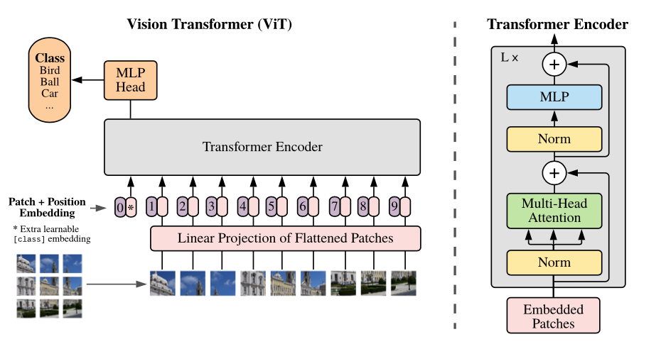
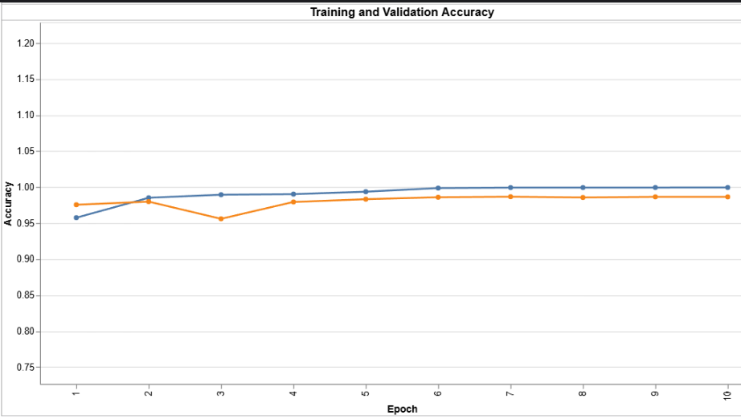
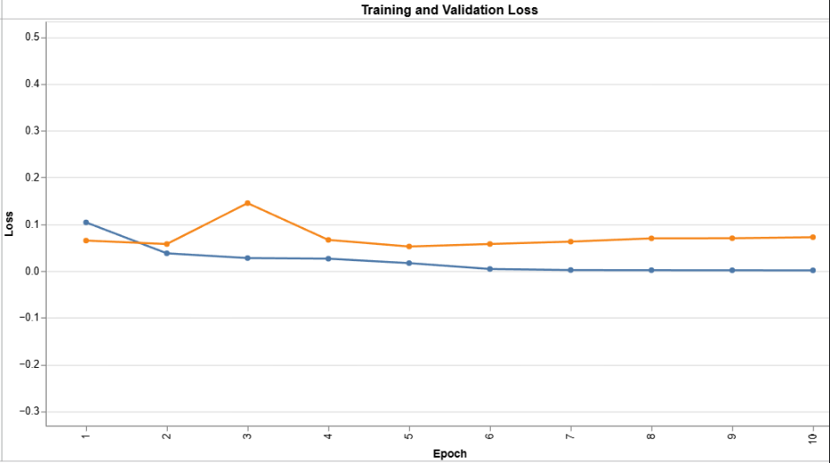
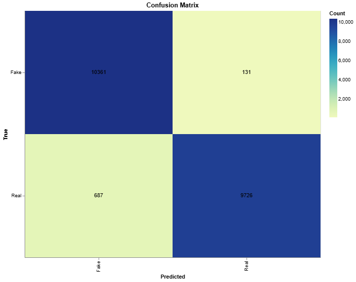

# Detection of Fake Facial Images Using Advanced AI Techniques

This project explores the detection of real and fake facial images using different deep learning architectures. It was completed as a final assignment for the **Pattern Recognition and Image Processing Lab** course at International Islamic University Chittagong in October 2024. The original project report, including the methodology, experimental results, and analysis, is available at [`report/project_report.pdf`](report/project_report.pdf).

## Project Overview

The main goal of this project was to explore different deep learning approaches for distinguishing authentic facial images from AI-generated or manipulated ones. We experimented with transformer-based architectures, self-supervised learning, and generative adversarial networks to compare their performance on this classification task.

## Dataset

We used the [Real and Fake Images Dataset for Image Forensics](https://www.kaggle.com/datasets/shivamardeshna/real-and-fake-images-dataset-for-image-forensics), collected from Kaggle and authored by Shivam Ardeshna.

The dataset contains approximately **230,000 facial images**, equally distributed between two classes:

- **Real:** Authentic facial images.
- **Fake:** Manipulated or artificially generated facial images.

The dataset consists of four sub-datasets and is divided into training, validation, and testing sets, maintaining a balanced distribution between the two classes.

## Models Explored

We experimented with four different architectures:

- **Vision Transformer (ViT):** Used a pretrained Vision Transformer with a modified classification head for real/fake image classification.
- **Compact Convolutional Transformer (CCT):** Explored a compact transformer-based architecture for image classification.
- **DINOv2:** Used pretrained DINOv2 as a feature extractor and added custom classification layers to utilize its self-supervised visual representations.
- **DCGAN:** Trained a Deep Convolutional Generative Adversarial Network on real facial images and used its discriminator for real/fake classification.

## Results

### Vision Transformer (ViT)

The Vision Transformer was one of the main classification models explored in this project. We used pretrained ImageNet weights and modified the final classification layer to classify facial images into real and fake categories.

The model was trained for 10 epochs using the AdamW optimizer with an initial learning rate of 0.001 and Cross-Entropy Loss.

The following table shows the performance reported in the original experiment.

| Metric | ViT |
|---|---:|
| Training Accuracy | 100% |
| Validation Accuracy | 99% |
| Test Accuracy | 96% |
| F1 Score | 0.96087 |

### ViT Training and Evaluation

**ViT Architecture**

<p align="center">
  
</p></Writing

**Training and Validation Accuracy**

<p align="center">
  
</p>

**Training and Validation Loss**

<p align="center">
  
</p>

**Confusion Matrix**

<p align="center">
  
</p>


Other model visualizations, including CCT, DINOv2, and DCGAN results, are available in the `images` directory.

## Repository Structure

```text
fake-facial-image-detection/
│
├── images/
│   ├── cct_accuracy.png
│   ├── cct_confussion.png
│   ├── cct_loss.png
│   ├── cct.png
│   ├── DCGAN_discriminator_val_accuracy.png
│   ├── dcgan_g.png
│   ├── dino_accuracy.png
│   ├── dino_loss.png
│   ├── dinov2.png
│   ├── training_image_sample.png
│   ├── vit_accuracy.png
│   ├── vit_confussion.png
│   ├── vit_figure.png
│   └── vit_loss.png
│
├── notebooks/
│   ├── 1. vit_classification.ipynb
│   ├── 2. dinov2_classification.ipynb
│   └── 3. dcgan_classification.ipynb
│
├── report/
│   └── project_report.pdf
│
└── README.md
```

## Important Notes

- The original experiments and report were completed in October 2024 as part of the course assignment.
- The CCT notebook is not available in this repository. However, some of its experimental plots and visualizations are included in the `images` directory.
- The DINOv2 and DCGAN notebooks currently contain only two training epochs. They are provided to demonstrate the code structure and show that the implementations can run, not to reproduce the original experiments.
- The original experimental metadata, including training checkpoints and complete training history, is not available.
- The results and visualizations included in this repository are from the original experiments. Running the currently available notebooks may not reproduce those results.

## Report

The complete project report is available here:

[`project_report.pdf`](report/project_report.pdf)

It includes the background study, related work, dataset description, model architectures, implementation details, experimental results, and conclusion.